  <picture>
    <source media="(max-width: 1011px) and (prefers-color-scheme: dark)" srcset=".github/assets/hero-narrow-dark.svg">
    <source media="(max-width: 1011px)" srcset=".github/assets/hero-narrow-light.svg">
    <source media="(prefers-color-scheme: dark)" srcset=".github/assets/hero-dark.svg">
    
  </picture>

I'm a builder. I like solving people's problems, and there are a lot of ways to do it: an app, a tool for a sales team, a better setup for the Little League I coach in. Most of what I build now, I build with AI agents. I decide what's worth building, set the rules, and check the work.

Day job: VP of Product Marketing at Centercode, a customer validation company. This account is what I build on my own time.

  <a href="#featured">Featured</a> ·
  <a href="#everything-ive-shipped">Everything I've shipped</a> ·
  <a href="#how-i-build">How I build</a> ·
  <a href="https://www.linkedin.com/in/crader">LinkedIn</a>

## Now building

- **[github-readme-designer](https://github.com/rader-ai/github-readme-designer)**: the skill that made this page. Tested on three of my repos so far.
- **SwingDino** ([swingdino.com](https://swingdino.com)): a hitting app for kids that grew out of coaching. In beta, powered by my swing and exit-velocity engines.

## Featured

<table>
  <tr>
    <td width="50%" valign="top">
      <picture>
        <source media="(max-width: 1011px) and (prefers-color-scheme: dark)" srcset=".github/assets/featured/lighthouse-fix-narrow-dark.svg">
        <source media="(max-width: 1011px)" srcset=".github/assets/featured/lighthouse-fix-narrow-light.svg">
        <source media="(prefers-color-scheme: dark)" srcset=".github/assets/featured/lighthouse-fix-dark.svg">
        
      </picture>
       <b><a href="https://github.com/rader-ai/lighthouse-fix">lighthouse-fix</a></b> 
      Turns a Lighthouse report into ranked fixes, real visitors first, with prompts a coding agent can run as-is.
    </td>
    <td width="50%" valign="top">
      <picture>
        <source media="(max-width: 1011px) and (prefers-color-scheme: dark)" srcset=".github/assets/featured/github-readme-designer-narrow-dark.svg">
        <source media="(max-width: 1011px)" srcset=".github/assets/featured/github-readme-designer-narrow-light.svg">
        <source media="(prefers-color-scheme: dark)" srcset=".github/assets/featured/github-readme-designer-dark.svg">
        
      </picture>
       <b><a href="https://github.com/rader-ai/github-readme-designer">github-readme-designer</a></b> 
      Redesigns a repo's README into an animated page that sells it, and shows you the before and after.
    </td>
  </tr>
</table>

## Everything I've shipped

**Skills for coding agents** (Claude Code, Codex, ChatGPT)
- [github-readme-designer](https://github.com/rader-ai/github-readme-designer): READMEs that sell the project, with motion that plays on GitHub.
- [lighthouse-fix](https://github.com/rader-ai/lighthouse-fix): Lighthouse and PageSpeed reports into ranked fixes and agent-ready prompts.
- [hackathon-skill](https://github.com/rader-ai/hackathon-skill): teams of agents build rival versions of an idea; judges grade them.
- [lasso](https://github.com/rader-ai/lasso): rewrites dense answers with a coach's warmth and everyday analogies.
- [auto-inspection-audit](https://github.com/rader-ai/auto-inspection-audit): checks an auto shop's inspection and estimate, for drivers and shop owners.

**Baseball and coaching**
- [baseball-swing-analysis](https://github.com/rader-ai/baseball-swing-analysis): grades a swing from phone video and gives one drill to work on.
- [exit-velo-eval](https://github.com/rader-ai/exit-velo-eval): estimates exit velocity from phone video, or says "no clean read" instead of guessing.
- [baseball-coach](https://github.com/rader-ai/baseball-coach): practice plans and drills for coaches of kids 4-12.
- [youth-baseball-league-benchmarks](https://github.com/rader-ai/youth-baseball-league-benchmarks): fees and sponsorship data from 37 Little Leagues, so a volunteer board can see where it stands.

**Motion and creative**
- [Glyphmotion](https://github.com/rader-ai/Glyphmotion): a design language and tiny engine for interfaces drawn in full-color text characters.
- [clay-motion](https://github.com/rader-ai/clay-motion): a stop-motion studio run from Claude Code, with Blender as the stage. Early.
- [lego-motion](https://github.com/rader-ai/lego-motion): brick-built films, same studio model. Design stage, no code yet.

**Sales and knowledge**
- [sales-call-review](https://github.com/rader-ai/sales-call-review): sales call transcripts into account timelines and a coaching report, with every quote checked.
- [Recording-Atlas](https://github.com/rader-ai/Recording-Atlas): turns recordings into a searchable, timestamped archive.

## How I build

Claude Code writes most of the code. I set the scope, write the rules, review the work, and decide when it's done. I try to say plainly what's been tested and what hasn't, so my skills ship with their evals: the same task, run with and without the skill, with the raw results in the repo.

<picture>
  <source media="(max-width: 1011px) and (prefers-color-scheme: dark)" srcset=".github/assets/receipts-narrow-dark.svg">
  <source media="(max-width: 1011px)" srcset=".github/assets/receipts-narrow-light.svg">
  <source media="(prefers-color-scheme: dark)" srcset=".github/assets/receipts-dark.svg">
  
</picture>

## How I got here

I love to build. I'm a creative with deep curiosity and a real passion for helping people, and almost everything I do, at work or outside it, ends up being about that. It's led me to coach, volunteer, lead teams, drive strategy, consult for large organizations, build for small businesses, and automate the manual stuff that eats up people's time.

I've led teams, but I still have an individual contributor's drive to make things myself. AI has opened doors for me, and this feels like the most exciting point in my career so far.

This page was made with <a href="https://github.com/rader-ai/github-readme-designer">github-readme-designer</a>. Its visuals are built by <a href=".github/readme/build.py"><code>.github/readme/build.py</code></a>.
